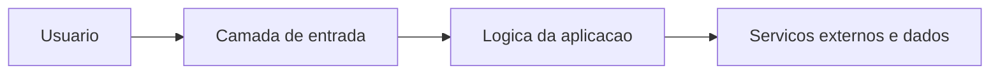

# Arquitetura — nestjs-api

Tecnologias: Node.js, NestJS, TypeScript e Kafka. Principais referências: src/, test/, package.json, api.http.

Modelo inicial de responsabilidades. Não é um diagrama exato da infraestrutura existente. Preserve contratos públicos e isole dependências externas para permitir testes.

**Limite:** O README antigo dizia Django, mas o manifesto comprova NestJS. O repositório inclui node_modules e dist rastreados: limpar em PR separado após build controlado.
